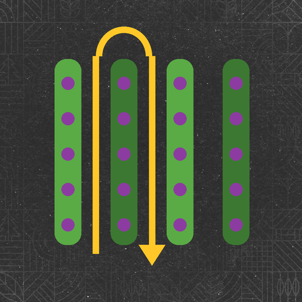

# Orchard AI Driver – FS25

The base game helper cannot work in vineyards, olive groves or coffee rows. **Orchard AI Driver can.**
Press **H** in your grape, olive or coffee harvester and the machine works the whole plantation by itself.

## Features
- **Right crop only**: a grape harvester works only vineyards, an olive harvester only olives, a coffee harvester only coffee
- **Finds the plantation by itself**: first and last row, the length of every row and the distance between rows
- **Drives from the farm**: press H far away from your plantation and the helper drives there on its own, lines up with the first row and starts working
- **Smart row order**: every second row on the way out, the rows in between on the way back
- **Clean headland turns**: U-turn or bulb turn depending on the row spacing, with a straight run to line up with the next row
- **Machine control**: lowered and turned on in the rows, lifted on the headland
- **Obstacles**: if a turn is blocked it backs up and tries another turn shape; it waits for vehicles in the way
- **Works without you**: leave the cab, a farmer takes your seat and the machine keeps working
- **Stops by itself** when the tank is full or all rows are done
- Route shown on the ground: green = work, orange = turn

## Controls
| Key | What it does |
|---|---|
| `H` | Start / stop (only on vine, olive and coffee machines) |
| `Alt + V` | Same as H |

## Console
| Command | What it does |
|---|---|
| `vaSpeed 10 7` | Work speed and turn speed (km/h) |
| `vaRadius 4` | Turning radius (m) |
| `vaSteerSign` | Flip the steering direction |

## Install
Download **FS25_OrchardAI.zip** from the [latest release](../../releases/latest) and put it in your `mods` folder. Do not unzip it.

## Info
- Game: Farming Simulator 25
- Multiplayer supported
- Languages: English, German, French
- Author: **FS Modding**

## License
Free to use. Do not reupload, sell or publish modified versions without permission. See [LICENSE](LICENSE).
